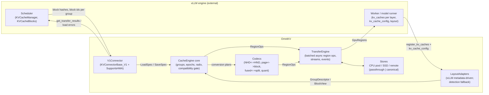
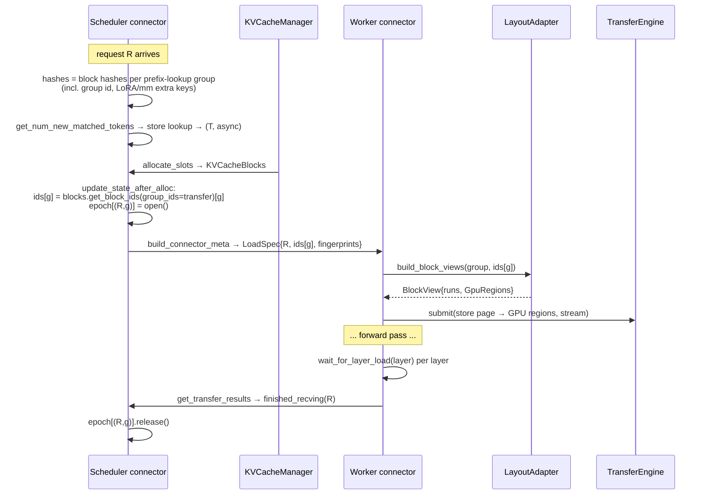

# OmniKV — Research and Architecture Design for a Layout-Agnostic KV Cache System

**Status:** Research complete; design proposed. No implementation has started.
**Date:** 2026-11-20
**Scope:** Phase 1 (research) through Phase 6 (roadmap) of the OmniKV task. This document is the required deliverable; coding is intentionally deferred.

**Verification legend used throughout this document:**

| Tag | Meaning |
|---|---|
| **[V]** | Verified directly from source code inspected for this document (file + line given, with commit). |
| **[VR]** | Verified from a secondary artifact produced by a prior local audit (e.g., FlexKV Phase 0 report), not re-verified against upstream commits by me. |
| **[A]** | Assumption or inference; must be validated before relying on it. |
| **[P]** | Proposed OmniKV design decision (not yet implemented anywhere). |

---

## 1. Executive Summary

OmniKV is a greenfield project (this repository is empty at the time of writing — **[V]**: `ls /Users/gc/Desktop/OmniKV` returned no files). Its goal is a high-performance, extensible KV cache system that supports the variety of physical layouts and semantic cache state types used across modern vLLM attention backends and model architectures, integrated through the vLLM V1 `KVConnectorBase_V1` interface.

**Key research findings:**

1. **vLLM has already converged on a byte-level, layout-parametric cache model.** On current `main` (commit `898a7c6`, ≈ v0.34.0), every cache layer is described by a `KVCacheSpec` whose page geometry is expressed in *bytes* (`state_content_size_bytes`, `page_size_bytes`, `tokens_per_state` which may be a `Fraction`), placed into a backing allocation by a `KVCacheTensor` (`offset + l*layer_stride + b*block_stride`), with the physical axis order given by a `KVCacheLayout` enum that is a 5-D stride permutation over logical axes `[L, B, H, N, C]` (RFC #42082). Heterogeneous cache groups (full attention, sliding window, Mamba, sparse indexer) *overlay one physical pool*: "tensors whose address ranges overlap alias the same bytes … sound because a block ID is owned by one group at a time" — this is the Hybrid Memory Allocator (HMA) model, paired with `HybridKVCacheCoordinator` and the `SupportsHMA` connector capability interface. **[V]**
2. **LMCache already demonstrates that layout-invariant transfer is achievable**, using: stride-sorted metadata-only view recovery; an `EngineKVFormat` enum whose name *is* the shape (`NL_X_TWO_NB_BS_NH_HS` …); `KVFormatSpec` static layout facts (`is_mla`, `is_hnd`, `is_fused_packed`, `is_two_major`, `supports_dim0_padding`, …); kernel-group partitioning by an 8-tuple identity that includes `engine_group_idx` and `block_stride_elems`; and reinterpretation edits that turn Mamba `(conv|ssm|pad)` pages into opaque synthetic attention views. Crucially, it also demonstrates where detection *fails*: heads-outermost layouts (`LHBNC`, `BHLNC`) are rejected with `NotImplementedError` because per-block content is fragmented per head. **[V]**
3. **FlexKV (local checkout, v1.0.0, Sept 2025) is the counter-example**: a rigid 6-D `KVCacheLayout` (`[L, kv_dim, B, N, H, C]` LAYERWISE, or BLOCKWISE) with a single `is_mla` flag. It is fast and simple, but cannot express HND-vs-NHD interior order as data, non-contiguous views, sub-paged or compressed states, hybrid groups, or per-layer heterogeneous formats. Upstream FlexKV has since moved on (library mode, vLLM mainline connector from v0.17.2) **[VR]**, but the local checkout's fixed-shape design is the architecture trap OmniKV must avoid.
4. **The strongest existing precedent for the core abstraction is the byte-region descriptor**, appearing independently in three places: vLLM's offloading connector (`CopyRun {local_offset, canonical_offset, fragment_size, num_fragments, local_stride, canonical_stride}` + `CanonicalPageMapping`), Mooncake store's `RankLocalStoreLayout` (`base_addr, block_stride, block_len` regions derived from real tensors), and MoRI's `LayerTransferGeometry`/`MambaTransferGeometry`. All three reduce arbitrary layouts to strided byte correspondences and let everything downstream be layout-blind. **[V]**

**Recommended architecture (detail in §4):** a *byte-region page model with pluggable layout adapters and explicit codecs*. The core engine never sees tensor dimensions or K/V ordering; it sees, per (cache group, layer, block), a set of strided byte regions plus a semantic `StateKind` tag. Layout adapters produce these descriptors from engine-supplied metadata (preferred) or verified stride detection (fallback). Compatibility is decided by a `FormatFingerprint` (layout family, dtype, quant mode, geometry, version): equal fingerprints ⇒ zero-copy passthrough; registered codec ⇒ explicit conversion; anything else ⇒ fail fast. Physical layout compatibility is thereby separated from *semantic* compatibility (what a "block" means, what restore requires), which is tracked by `StateKind` and per-kind restore contracts.

**Primary trade-off:** passthrough of native layouts maximizes zero-copy performance but fragments the store by format; canonicalization maximizes portability but pays a repack on every save/load. OmniKV chooses passthrough-with-fingerprint as the default and canonical/codec paths as explicit opt-in, following the evidence that this is what vLLM's own offloading stack and Mooncake do.

**Implementation order:** M1 (same-engine MHA/GQA block save/restore, correctness-first) → M2 (BlockView + adapters for separate/fused/HND/NHD/non-contiguous) → M3 (async transfers, batching, storage backends) → M4 (MLA, sliding window, hybrid groups; recurrent states only after semantic validation) → M5 (benchmarks vs LMCache/FlexKV configurations, matrix validation).

---

## 2. Existing Systems

### 2.1 vLLM (main @ `898a7c68c2d1e869ebde2ce25ffbfc1e253bf0b4`, inspected 2026-11-20; release v0.34.0 dated 2026-11-16)

#### 2.1.1 The KV cache object model

Verified from `vllm/v1/kv_cache_interface.py` **[V]**:

- **`KVCacheSpec`** (frozen dataclass): `block_size`, `dcp_sharded`, `block_stride_alignment`. Abstract properties: `num_heads`, `tokens_per_state: int | Fraction`, `state_content_size_bytes`, `page_size_bytes`. `tokens_per_state` documents the two compression directions: ints > 1 compress multiple tokens into one state (DeepSeek-V4 sparse MLA); fractions < 1 store multiple states per token (Whisper block pooling, `Fraction(1, block_pool_size)`).
- **`AttentionSpec(KVCacheSpec)`**: `num_kv_heads`, `head_size`, `head_size_v`, `dtype`, `kv_quant_mode`, `page_size_padded`, plus the packing escape hatches: `num_head_slots` (H of the logical `[B, H, N, C]` page when packing diverges from one slot per KV head; "H2ND" head-major packing via `kv_head_major_slots`), `state_content_bytes` (C in bytes when packed; `None` means dense K/V content where `C = (head_size + head_size_v) * dtype_size`). `state_content_size_bytes` therefore already treats K+V as *one byte-level content cell*.
- **`MLAAttentionSpec(AttentionSpec)`**: single latent plane, `head_size_v = 0` ("MLA stores a single latent vector per state; there is no separate V"), `cache_dtype_str`, DeepSeek-V4-only `alignment`/`model_version` (alignment pads `page_size_padded`). `HiddenStateCacheSpec(MLAAttentionSpec)` marks hidden-state cache layers.
- **`MambaSpec(KVCacheSpec)`**: `shapes: tuple[tuple[int, ...], ...]`, `dtypes: tuple[torch.dtype, ...]` — *multiple differently-shaped state tensors per page*; `state_alignment` (byte alignment of each state within a page), `page_size_padded`, `mamba_type`, `tp_replicated` (False: sharded across TP, e.g. GDN; True: replicated, e.g. PLE conv state).
- **`KVQuantMode`**: 14+ modes including `FP8_PER_TENSOR`, `INT8/FP8_PER_TOKEN_HEAD`, `INT4_PER_TOKEN_HEAD` (packed 2×int4/byte), `NVFP4` (packed fp4 + fp8 block scales), `NVFP4_DS_MLA`, `TURBOQUANT_*` (Hadamard-rotated Lloyd-Max, *packed K+V per slot*), `ULTRAQUANT_4BIT`, `OCTAVE_*`, and `CUSTOM` (backend self-manages kernel dispatch). `DS_MLA_STATE_CONTENT_BYTES = {"fp8_ds_mla": 656, "nvfp4_ds_mla": 352}` with the comment: "ds_mla layouts pack NoPE + RoPE + scales into one opaque per-token blob, so the page size is not derivable from head_size."
- **`KVCacheTensor`** (the physical placement): `size` (bytes), `layers: list[str]`, `layer_stride`, `block_stride`, `offset`. Docstring: "Layer `layers[l]`'s page for block `b` starts at `offset + l * layer_stride + b * block_stride` bytes into the backing allocation … Tensors whose address ranges overlap alias the same bytes: cache groups overlay each other, which is sound because a block ID is owned by one group at a time."
- **`KVCacheGroup`**: `kv_cache_specs: dict[str, KVCacheSpec]`, `manager_config: ManagerConfig`, `block_size`, `dcp_sharded`, `is_eagle_group`, `host_resident`, `enable_kv_transfer` ("ephemeral accelerator-side replicas are rebuilt from their transferable source group after a connector load"), `role` (DEFAULT / HISPARSE_INDEXER). `page_size_bytes` = sum over the group's layers.
- **`ManagerConfig`** = `manager_cls + Params` (allocation policy); "layers whose configs compare equal may share a block table."
- **`KVCacheConfig`**: `num_blocks`, `kv_cache_tensors: list[KVCacheTensor]`, `kv_cache_groups`, `kv_cache_layout: str | None` ("resolved by the engine core, adopted by all workers"), `hash_block_size`, `cache_hit_alignment_tokens`, `kv_tp_replicas`, `needs_kv_cache_zeroing` (True iff `has_mamba_layers or has_mixed_precision_kv_cache`), plus derived views `transfer_group_ids`, `prefix_cacheable_group_ids`, `transfer_group_index_by_layer`, `select_transfer_block_ids()`.
- **`compute_layer_kv_cache_shape_bytes`** returns the logical 4-D shape `(B, H, N, C)` *with C in bytes*; `compute_layout_strides` produces byte strides for `[L, B, H, N, C]` from a layout permutation, honoring `page_size_padded`; `create_kv_cache_views` materializes per-layer views with `torch.as_strided` over the raw int8 buffer, and *errors fail-fast* when kernel-block splitting is impossible in the chosen layout: "The resolved KV cache layout … does not store blocks as contiguous pages … Reduce `--block-size` … or set `VLLM_KV_CACHE_LAYOUT` to a layer-compact layout (e.g. LBNHC)."

#### 2.1.2 The layout descriptor

`vllm/v1/kv_cache_layout.py` **[V]**: `KVCacheLayout` is an enum of stride permutations over logical dims `[L, B, H, N, C]` (`_DIM_L.._DIM_C = 0..4`, "RFC #42082"):

| Member | Physical order | Properties |
|---|---|---|
| `LBHNC` | L,B,H,N,C | layer-compact, block-compact ("HND" per layer) |
| `LBNHC` | L,B,N,H,C | layer-compact, block-compact, block-contiguous ("NHD" per layer) |
| `LHBNC` | L,H,B,N,C | layer-compact only — pages fragmented per head |
| `BLHNC` | B,L,H,N,C | block-outermost ("HND", layers packed per block) |
| `BLNHC` | B,L,N,H,C | block-outermost ("NHD") |
| `BHLNC` | B,H,L,N,C | fragmented per head |

Helper predicates: `is_layer_compact`, `is_block_contiguous` ("[H, N, C] contiguous within a block"), `is_block_compact` ("each page's [H, N, C] bytes form one contiguous run; L and B outermost"), `is_block_outermost`. This enum is *the* answer vLLM gives to "how do I describe layout without hardcoding it": order is data, not code.

#### 2.1.3 KVCacheManager, groups, and the Hybrid Memory Allocator

- **`KVCacheBlocks`** (`vllm/v1/core/kv_cache_manager.py` lines 34–130 **[V]**): allocation result; `blocks: tuple[Sequence[KVCacheBlock], ...]` — *outer dimension is the cache group*. `get_block_ids(group_ids=...) -> tuple[list[int], ...]`. The docstring explicitly anticipates groups with different block counts (and someday different block sizes).
- **`KVCacheManager`**: `get_computed_blocks`, `get_computed_blocks_for_connector` (connector-visible prefix matching), `allocate_slots`, `get_block_ids(request_id)`. **[V]**
- **`HybridKVCacheCoordinator`** (`vllm/v1/core/kv_cache_coordinator.py` line 629 **[V]**): "coordinator for hybrid models with multiple KV cache types"; enforces e.g. "DCP with hybrid KV cache layouts only supports [constraints]"; implements "simple hybrid (1 full attn + 1 other)" fast paths and cross-group hit accounting (sparse-retention groups).
- **`SingleTypeKVCacheManager`** subclasses (`vllm/v1/core/single_type_kv_cache_manager.py`, 3477 lines **[V]**): `FullAttentionManager`, `SlidingWindowManager` (conditionally prefix-cacheable), `RSWAManager`, `DFlashSlidingWindowManager`, `ChunkedLocalAttentionManager`, `CrossAttentionManager`, `MambaManager`. Each exposes class-level policy: `prefix_cacheable(config)`, `uses_slot_mapping`, `zeroes_new_blocks`, `block_table_token_alignment`.
- **`MambaManager` semantics** (line 1934+ **[V]**): default mode allocates `1 + num_speculative_blocks` state blocks per request — *a Mamba block holds ONE recurrent state snapshot, not tokens*; `mamba_cache_mode == "align"` is required for Mamba prefix caching ("Mamba prefix caching requires mamba_cache_mode='align'"); align mode may "null interior states and relocate speculative blocks in place" so `has_positionally_stable_blocks` is False; the block-table row is position-indexed over the full sequence length; **Mamba state is replicated across DCP/PCP ranks, never sharded**. Prefill checkpointing helpers (`get_mamba_prefill_checkpoint_position`, `is_mamba_prefill_checkpoint_valid`) define when a backend can export a state snapshot mid-prefill (alignment, query bounds).
- **Allocation/placement is pluggable**: `KVCacheConfigBuilder` (`vllm/v1/core/kv_cache_config_builder.py` **[V]**) is a platform hook (`Platform.get_kv_cache_config_builder_cls`) with `get_kv_cache_groups` (grouping; models may own grouping via `SupportsKVCacheGrouping`) and `get_kv_cache_config_from_groups` (materialize tensors for a block count); `_get_pool_bytes_per_block` is documented as transitional "expected to go away with worker-driven allocation (RFC #42449)". All device backings share one allocation; "each device backing's size is `bytes_per_block * num_blocks`".

**HMA summary [V]:** the "hybrid memory allocator" on current main is the combination of (a) one shared physical pool per device whose bytes are addressed by `(KVCacheTensor.offset, layer_stride, block_stride)`, (b) heterogeneous `KVCacheGroup`s whose tensors *overlay* the pool (aliasing is safe because a block ID belongs to exactly one group at a time), coordinated by `HybridKVCacheCoordinator`, and (c) the `SupportsHMA` connector interface (§2.1.5) that gives connectors an all-groups lifecycle hook. The v0.34.0 extensible-KV-cache release notes additionally harden connectors against the new sizing path. **[VR]** (release-notes claim; mechanism verified in code.)

#### 2.1.4 How backends allocate and expose tensors; block→token mapping

- The model runner resolves layout centrally: `init_kv_cache` calls `allocate_kv_cache(kv_cache_config, device, vllm_config.cache_config.get_resolved_kv_cache_layout(), kernel_block_sizes)` then binds per-layer views (`bind_kv_caches`; cross-layer KV-sharing layers alias another layer's view: `get_shared_kv_cache_layers`). **[V]** (`vllm/v1/worker/gpu/attn_utils.py` lines 397–449)
- "Kernel blocks": a manager block of `block_size` tokens may be split into uniformly-strided kernel blocks (e.g. block 64 for scheduling, 16 for the kernel); `group_kernel_blocks` views `(num_blocks * ratio, ...)` → `(num_blocks, ratio, ...)`; specs may require `block_stride_alignment` or `MultipleOf(n)` alignment between physical blocks. **[V]**
- Logical token `t` of a request maps to block `t // block_size`, slot `t % block_size` within that block's page; `uses_slot_mapping` marks caches written through per-token slots vs. those that "already address its pages."
- **Block→request mapping for connectors**: the scheduler passes `KVCacheBlocks` to `update_state_after_alloc`; `KVCacheBlocks.get_block_ids(group_ids=...)` yields per-group block-ID lists; `request_finished(request, block_ids: list[int])` (single group) vs. HMA's `request_finished_all_groups(request, block_ids: tuple[list[int], ...])`. **[V]**

#### 2.1.5 KVConnectorBase_V1 lifecycle and capability surface

Verified in full from `vllm/distributed/kv_transfer/kv_connector/v1/base.py` (861 lines) **[V]**. Constructor: `__init__(vllm_config, role, kv_cache_config)` — the connector *receives the resolved KVCacheConfig*, so per-group specs, tensors, and layout are available at init time on both roles.

**Scheduler-side hooks:**

| Hook | Contract (verbatim-condensed) |
|---|---|
| `get_num_new_matched_tokens(request, num_computed_tokens) -> (int \| None, bool)` | External tokens beyond `num_computed_tokens`; `None` = "needs more time, scheduler will re-query"; `True` = async load; must consider only the largest prefix *actually available now*; may be called multiple times, side-effect free. |
| `update_state_after_alloc(request, blocks, num_external_tokens)` | After block allocation; may be called twice for async loads (allocation for loading, then post-load); "decide whether to load based on `num_external_tokens`, not on whether `blocks` is empty". |
| `build_connector_meta(scheduler_output) -> KVConnectorMetadata` | Per-step; must not mutate `scheduler_output` (one documented exception for synchronous READ connectors zeroing blocks); "calling this function will reset the state of the connector". |
| `update_connector_output(connector_output)` | Ingest worker-side completions. |
| `request_finished(request, block_ids) -> (bool, params \| None)` | Exactly once before blocks are freed; `True` = connector owns freeing until `get_finished`/`get_transfer_results` returns the id. |
| `get_loaded_kv_cache_group_ids(request)` | "KV cache groups restored by this connector's load" — defaults to `prefix_cacheable_group_ids`; this is how hybrid-aware schedulers learn *which* groups a connector restored. |
| `get_external_cache_hit_sources(request, num_external_tokens)` | Split hits by tier (HOST/DISK/P2P) for metrics. |
| `may_load_async(request)` | Cheap predicate used by `--max-num-inflight-kv-loads` to overlap loads with a full running batch. |

**Worker-side hooks:**

| Hook | Contract |
|---|---|
| `register_kv_caches(kv_caches: dict[str, torch.Tensor])` | Pre-register device caches (e.g. for NIXL/RDMA memory registration). |
| `on_kv_cache_ready()` / `unregister_kv_caches()` / `restore_kv_caches()` | Deferred registration after final sizing; sleep-mode lifecycle. |
| `start_load_kv(forward_context)` | Begin loads; "loads required by the current forward start before it". |
| `wait_for_layer_load(layer_name)` | Per-layer barrier called from inside the attention layer — the layer-pipelining seam. |
| `save_kv_layer(layer_name, kv_layer, attn_metadata)` | Per-layer async save kickoff from inside the layer. |
| `wait_for_save()` | Per-step submission + sync; "async saves must retain their source blocks until completion is reported to the scheduler". |
| `get_finished(finished_req_ids) -> (sending, recving)` | Legacy snapshot API. |
| `get_transfer_results(finished_req_ids) -> KVConnectorTransferResults` | Combined `finished_sending / finished_recving / failed_recving` snapshot; failed receives *also* appear in `finished_recving` so the scheduler can release the request. |
| `get_block_ids_with_load_errors() -> set[int]` | Per-forward reporting of failed block loads (sync: same pass; async: no later than the pass where the request finishes receiving). |
| `handle_preemptions(kv_connector_metadata)` | "Handle preempted requests or evicted blocks BEFORE they are overwritten." |
| `set_host_xfer_buffer_ops(CopyBlocksOp)` | Engine-provided H2D/D2H copy op over `dict[str, Tensor]` layer→tensor maps ("needed when host buffer is used for kv transfer"). |
| `build_connector_worker_meta()` | Worker→scheduler metadata (aggregated across workers). |

**Capability surface (class-level):**

- `SupportsHMA(ABC)`: `request_finished_all_groups(request, block_ids: tuple[list[int], ...]) -> (bool, params | None)`; `supports_hma(connector)` checks subclassing; "required to use the connector together with hybrid memory allocator." **[V]** (lines 102–137)
- `kv_cache_access(kv_transfer_config) -> KVCacheAccess`: how workers reach the device cache (default `IN_PROCESS`; `REGISTERS` when a UCX/RDMA engine registers it, "which requires each segment to be backed by a single physical allocation" — this constrains which layouts the extensible KV cache may produce for such connectors). **[V]**
- `get_required_kvcache_layout(vllm_config) -> str | None`: e.g. `"HND"` or `"NHD"`; connector can force the engine's layout. **[V]**
- `only_restores_canonical_kv() -> bool`: "Whether every KV block it loads is a whole block that vLLM's own cache writer produced for an identical KV cache layout. Attention backends may then keep fast paths that assume no foreign bytes (e.g. NaNs in unwritten slots) ever reach the KV cache." — the engine's formal hook for the exact risk OmniKV's fingerprint gate must manage. **[V]**
- Also: `requires_kv_delivery` (preempted handoffs recompute rather than deliver freed blocks), `supports_sleep_mode`, `supports_lookahead_block_hashes`, `supports_divergent_local_hybrid_hits` (connector can complete hybrid hits by restoring lagging recurrent state), `requires_piecewise_for_cudagraph` (async layer hooks cannot be captured in full CUDA graphs — "will be skipped during replay, causing data races"), `has_pending_block_frees`, `has_pending_push_work`, `reset_cache`. **[V]**

#### 2.1.6 vLLM's own layout-agnostic machinery inside the tree (strong design evidence)

- **Offloading connector canonical mapping** (`.../v1/offloading/canonical_mapping.py` + `vllm/v1/kv_offload/base.py`) **[V]**: "The only place in the offloading stack that reasons about parallelism (TP/DCP/PCP); everything downstream consumes byte mappings. The canonical page of a layer is the full offloaded block without parallelism: all KV heads, all `block_size * dcp * pcp` tokens, in the worker's page encoding. **Uncertifiable layers get an opaque fallback mapping (fail closed).**" `CopyRun {local_offset, canonical_offset, fragment_size, num_fragments, local_stride, canonical_stride}`; `CanonicalPageMapping {canonical_page_size_bytes, local_page_size_bytes, runs, num_writers, writer_index}`; `CANONICAL_FORMAT_VERSION = 1` with `canonical_format_id()` namespacing persisted KV by `(version, layout family)` — "consumers must match it exactly." `_packed_kv_regions` certifies NHD/HND by *checking the actual strides* (`head_stride == head_elems and token_stride == heads*head_elems`), returning `None` otherwise. `_coalesce_runs` collapses contiguous fragments to minimize copy ops.
- **Mooncake store layout** (`.../v1/mooncake_store/layout.py`) **[V]**: `RankLocalStoreLayout.register_kv_caches` derives, from the real tensors: kernel-block grouping + a `block_compact` flag ("tail padding in every kernel block makes it non-dense although no other block's data sits in the gaps"); per-head regions when a manager block is not compact; one whole-storage region for block-outermost buffers; `block_len` = bytes actually stored ("up to the last byte of the group's data, skipping e.g. the padding of a Mamba state up to the attention page size"). `prepare_values` produces batched `(addrs, sizes, block_ids)` descriptors. `TPShardedStoreLayout` handles cross-TP store chunking; `PoolKey` namespaces by `(model, tp/pcp/dcp/pp rank, group_id, cache_prefix, store_namespace)`.
- **MoRI layout** (`.../v1/moriio/moriio_layout.py`) **[V]**: `LayerTransferGeometry(num_blocks, block_size, block_len, slot_size_bytes, block_stride, local_kv_stride, remote_kv_stride, transfers_per_block, regions_per_block, split_kv_regions)`; `MambaTransferGeometry` derives conv/ssm slot strides and caps registered regions at the storage extent ("a packed conv+ssm page places ssm at a non-zero intra-buffer offset, so do not register past the end of the shared backing allocation").
- **FlexKV connector in-tree** (`.../v1/flexkv_connector.py`) **[V]**: thin shim over `flexkv.integration.vllm.vllm_v1_adapter.FlexKVConnectorV1Impl`; all worker-side hooks are no-ops because "FlexKV manages all KV transfers on the scheduler side … KV blocks are transferred directly between the FlexKV server and vLLM's GPU memory … similar to how NIXL operates."

#### 2.1.7 Version-skew warning (directly relevant to OmniKV)

The connector API is explicitly experimental: `__init__` logs "This API is experimental and subject to change." **[V]** The task brief names `get_transfer_results` — verified as current main's combined snapshot API **[V]**; the older `get_finished`-only contract (used by the local FlexKV checkout against vLLM 0.10.1.1) is still present as the overridable base. The LMCache adapter notes the pre/post-#51718 layout-query split and the #61452 allocation-policy refactor, both of which required adapter-side compatibility shims **[V]**. OmniKV must pin one vLLM version per milestone and isolate version probing in one module.

### 2.2 LMCache (dev @ `53bde913de1adae2a380fe0c2de8d2b9355b4702`, inspected 2026-11-20)

LMCache is the most complete existing realization of "layout-invariant GPU connector". Its architecture, verified from source **[V]**:

1. **Canonical input structure**: `DiscoverableKVCache = Union[torch.Tensor, list["DiscoverableKVCache"]]` — a recursive tensor tree; engines unwrap their containers (`dict[str, Tensor]` for vLLM) before calling in. `LayoutHints` TypedDict carries engine-supplied facts: `kv_layout: "NHD" | "HND" | "BLHNC" | "BLNHC"`, `num_kv_heads`, `tokens_per_block`, `head_dim`. (`lmcache/v1/common/kv_format/types.py`)
2. **Contiguity recovery** (`contiguity.py`): `attempt_permute_to_contiguous_view` — a *metadata-only* stride-sorted dim permutation ("Recovers the vLLM HND case: tensors allocated physically as `[2, NB, NH, BS, HS]` but exposed logically as `[2, NB, BS, NH, HS]` via a dim permute. Sorting dims by stride undoes the permute without touching storage"), with tie-breaking for size-1 dims. It "deliberately never falls back to `.contiguous()`" to preserve zero-copy. For tensors that remain non-contiguous, `_validate_dim0_padded_layout` accepts exactly one shape of non-contiguity — dim-0 (per-block) padding only, with tight interior packing — and *rejects everything else with a detailed error* ("Downstream KV transfer kernels only understand dim-0 block-row padding; other strided views would produce wrong reads/writes"). This is the DeepSeek-V4 shared-pool case where compressor/indexer groups get per-block padding to a model-wide maximum.
3. **Format identity as data** (`specs/base.py`): each `EngineKVFormat` enum name *is* its shape ("`_`-joined tokens, with `X` marking a list level. `TWO_X_NL_X_NBBS_NH_HS` reads as `2 x NL x [PBS, NH, HS]`"), with 20+ concrete specs (`nl_x_nb_two_bs_nh_hs.py`, `nl_x_nb_bs_nh_cs.py`, `nl_x_nb_bsv_bss.py`, …). `KVFormatSpec` declares static layout facts as `ClassVar`s — structural (`is_cross_layer` / `is_kv_list` / `is_layer_list`, exactly one true) and modifiers (`is_mla`, `is_hnd`, `is_fused_packed`, `is_two_major`, `is_pbs_fused`, `is_kv_second_tuple`, `is_single_kv`, `requires_blocked_scale_repacking`, `supports_dim0_padding` — "explicit opt-in: only set it for layouts verified end to end"). Geometry accessors (`num_layers`, `num_blocks`, `block_size`, `kv_size`, `num_heads`, `head_size`, `dtype`, `data_ptrs`) plus reconstruction helpers (`paged_layer_shape`, `paged_pointer_shape`, `staging_shape`). Kernel-relevant facts are mirrored in `csrc/engine_kv_format.h` and pinned to Python by test. Specs *borrow* the tensors (transient lifetime, never cached on long-lived objects).
4. **Detection** (`detection.py`, `detectors/vllm.py`): `detect_format` = permute-to-contiguous → engine detector → `(format, normalized view)`; raises `ValueError` when no detector or no matching format. The vLLM detector dispatches on (list depth, tensor rank, leading dims) with explicit hints: rank-4 = fused K/V (the only unambiguous rank); rank-5 with K/V axis first vs. blocks first; rank-3 = MLA or DSA indexer (uint8 last-dim 132 = 128 fp8 values + fp32 scale); depth-2 = per-layer `(K, V)` tuples; RBLN singleton-dim variants with an explicit ambiguity warning ("RBLN KV cache shape … fits both the K/V-first and the blocks-first layout (`num_blocks == 2`); assuming K/V-first"). Defaults: `HND` on CPU backend, `NHD` elsewhere when no hint is given.
5. **Kernel/object group partitioning** (`kv_layer_groups.py`): `KernelGroupIdentity = (kv_size, num_heads, head_size, block_size, engine_group_idx, dtype, engine_kv_format, block_stride_elems)` — "block IDs are only meaningful within one group, so layers from different groups must not share an LMCache group even if shape and dtype match"; `engine_kv_format` in the key splits mixed formats within one engine group (K+V main cache alongside key-only indexer). `KernelGroupInfo` adds `sw_size_tokens`, `recurrent_state`, `tokens_per_block` (compression ratio), `extra_object_group_tag`; `calculate_slots(tokens) = tokens * slots_per_block // tokens_per_block` handles compressed/uncompressed uniformly. `ObjectGroupInfo` groups kernel groups by prefix-matching semantics (sliding-window size, recurrent).
6. **Engine group metadata from vLLM** (`integration/vllm/kv_cache_groups.py`): builds `EngineGroupInfo(engine_group_id, layer_indices, tokens_per_block, sw_size_tokens, recurrent_state, tp_replicas, dcp_shards)` from vLLM's `KVCacheConfig`, with class-name duck-typing so the module imports without vLLM; recognizes scratch specs (`prefix_cacheable` False — per-request rings like `CircularBufferSpec`/`KpoolTailSpec`), align-mode Mamba, DCP token multiplication for attention vs. replication for recurrent state, and `EXCLUDED_ENGINE_GROUP` for cross-layer KV-sharing layers "whose KV lives in their target owner's blocks."
7. **Structural edits for non-standard pages** (`integration/vllm/kv_cache_group_edits.py`): `KVCacheGroupEdit` rules — `matches` (pure) + `apply` (must return a *view*, never a copy). `_MambaPageViewEdit` reinterprets the padded `(conv | ssm | pad)` page as `[NB, 2, BS, 1, HS]` in the conv dtype, "equivalent for caching purposes to one block of a sliding-window attention layer with window == block_size: only the last matched block is ever consumed … The view's dims are addressing metadata only; the bytes are opaque." `_MambaSlicePlaneEdit` handles slice-strided conv/ssm (vLLM-Ascend ≤ 0.29) as uint8 planes. Subpaged-view edits handle sub-paged attention/MLA planes; the registry is gated on `kv_cache_config.has_mamba_layers`.
8. **Layout hints plumbing & known rejections** (`integration/vllm/utils.py`): `translate_vllm_kv_cache_layout` maps `LBNHC→NHD`, `LBHNC→HND`, passes `BLHNC/BLNHC` through, and **raises `NotImplementedError` for `LHBNC`/`BHLNC`**: "LMCache does not support the … KV cache layout: per-block content is fragmented per head." Legacy CPU/neuron/mlu normalization to HND. Cache-key hygiene: LoRA tag = BLAKE2b(name‖path) ("a name re-pointed at different weights misses instead of hitting stale KV"); multimodal placeholder substitution — per-position pseudo-token values derived from SHA-256 chains (31-bit, prefix-consistent) so "two different images would produce identical chunk hashes" is prevented.
9. **vLLM adapter** (`vllm/distributed/kv_transfer/kv_connector/v1/lmcache_integration/vllm_v1_adapter.py`, in the vLLM tree) **[V]**: `register_kv_caches` stores the dict and calls `lmcache_engine.post_init(kvcaches=list(dict.values()))`; per-request `LoadSpec`/`SaveSpec`; scheduler-side lookup client (async option); worker-side layerwise retriever/storer generator pipelines for `start_load_kv`/`save_kv_layer`; `discard_partial_chunks`, `chunk_size`, `save_decode_cache`, `skip_last_n_tokens` policies.

**Known limitations / compatibility constraints (verified):** heads-outermost layouts rejected **[V]**; dim-0 padding is the only supported non-contiguity **[V]**; detection ambiguities exist and are only warnings in some paths **[V]**; MP (multi-process) and non-MP paths derive geometry differently (`PageBufferShapeDesc` per group vs. spec accessors) **[V]**.

### 2.3 FlexKV (local checkout @ `7cf7118` "Merge PR #10", 2025-09-11, v1.0.0; plus local Phase 0 audit commit `3d51cbe`)

All file references are to `/Users/gc/Desktop/FlexKV`. **[V]** for code, **[VR]** for upstream-history claims.

1. **Architecture** (`README_FLEXKV.md`): StorageEngine (three-level block storage, "maintaining the same KV shape as in GPU memory … actual storage offset is calculated via block ID"; optional *block-wise mode* merging layers+KV into larger blocks for I/O), GlobalCacheEngine (radix tree + mempool per tier; fragment-based tier composition; logical LRU eviction), TransferEngine (multi-threaded, io_uring). Async get/put with prefetch overlap.
2. **Layout model** (`flexkv/common/storage.py` lines 18–155): `KVCacheLayoutType {LAYERWISE, BLOCKWISE}`; `KVCacheLayout(type, num_layer, num_block, tokens_per_block, num_head, head_size, is_mla)`; computed `kv_shape` is exactly `[L, kv_dim, B, N, H, C]` (LAYERWISE) or `[B, L, kv_dim, N, H, C]` (BLOCKWISE) with `kv_dim = 2` or `1` (MLA). Stride accessors derive from this one canonical shape. Constraints enforced in `StorageEngine.__init__`: "Only layerwise layout is supported for GPU"; SSD/remote layout types must equal the CPU layout type. *This is a layout-structured but rigid design: HND-vs-NHD interior order, per-layer heterogeneous formats, sub-paging, compression ratios, and non-contiguous views are all inexpressible.*
3. **GPU registration** (`flexkv/integration/vllm/vllm_v1_adapter.py` lines 536–564): `register_to_server` inspects tensors and *asserts* ranks: 3-D for MLA (`[num_blocks, block_size, head_size]`), 5-D otherwise with `num_blocks = shape[1]` — i.e. it hardcodes both the K/V packing and dim positions of one vLLM-era layout.
4. **Transfer planning** (`flexkv/cache/cache_engine.py`): `GlobalCacheEngine.get/put` produce a `TransferOpGraph` of `TransferOp`s (`H2D/D2H/DISK2H/H2DISK/H2REMOTE/REMOTE2H`) over `(src_block_ids, dst_block_ids, layer_id=0, layer_granularity=num_layers)`; layerwise transfer raises `NotImplementedError` ("Layerwise transfer is not supported yet") in this checkout. Readiness: radix nodes inserted `is_ready=False`, locked, then `cleanup(node, length)` marks ready after transfer — i.e. **eviction is prevented until bytes actually land**, a correctness-critical pattern OmniKV should replicate.
5. **Scheduler integration** (same file): `get_num_new_matched_tokens` → radix match with a token mask; `update_state_after_alloc` computes GPU slot mappings from `blocks.get_block_ids()[0]` (single group assumption — `blocks.get_block_ids()[0]` takes the *first* group only); `request_finished` triggers put-match of unmatched blocks; `build_connector_meta` = `cancel_tasks()` + `launch_tasks()`; worker-side `start_load_kv`/`save_kv_layer` are pass-through no-ops (transfers driven scheduler-side through the KVTP server via ZMQ + CUDA-IPC handles).
6. **Phase 0 audit findings** (`docs/fluxkv/PHASE0_AUDIT.md`) **[VR]**: clean-run match cost 0.31–0.46 ms; per-task transfer cost 10.85–21.04 ms at ~0.6–0.8 MB payloads — attributed to cross-process submit/complete round trips of the pre-library architecture; the historical ~40 ms match latency was a debugger artifact. Upstream timeline (from the audit, not re-verified by me): library transition commit `0290841` (2025-09-11/Nov 2025), GDS (Dec 2025), TRT-LLM + Mooncake TE (Jan 2026), NVIDIA Dynamo merge (Mar 2026), **vLLM mainline connector (PR #34328) → built in from vLLM v0.17.2 (Mar 2026)**, in-process layerwise transfers (`FLEXKV_ENABLE_LAYERWISE_TRANSFER`, Jun 2026), SGLang + DeepSeek-V4 (Jul–Oct 2026).
7. **Implication for OmniKV:** the local FlexKV is a useful *control* for single-layout performance and for the readiness/locking patterns, but its layout model is exactly the "hardcoded dims" anti-pattern the task forbids. OmniKV should not be built on top of it; at most M5 benchmarks against an upstream FlexKV configuration.

### 2.4 Additional context inspected

- **Mooncake (local clone, FAST'25; arXiv:2407.00079)**: transfer-engine-centric KV store; motivates separating metadata decisions from async movement. The vLLM-side `mooncake_store/layout.py` (§2.1.6) is the practically relevant layout evidence. **[V]** for layout code.
- **StrataKV (local, `~/Desktop/StrataKV`)**: a C++20 KV-runtime *proposal* (metadata/control/data planes, pybind11, thin vLLM adapter). OmniKV's layout abstraction should be designed so a future native core could implement the same interfaces; this document stays at the Python/API level as the task requires. **[V]** (README/CHANGELOG only — no implementation exists).
- **LMCache paper**: arXiv:2510.09665 (2025) — modular connector boundaries, batched transfers, compute/I/O overlap, tiered storage. **[VR]** (citation only).

---

## 3. KV Cache Layout Taxonomy

This section classifies the *physical* representations (what bytes look like) and *semantic* classes (what the bytes mean and what correct restore requires). The distinction is load-bearing: **physical layout compatibility** answers "can these bytes be moved without reinterpretation"; **semantic cache compatibility** answers "does restoring these bytes reproduce the model state."

### 3.1 Semantic state kinds

| StateKind | Examples | What a "block" holds | Restore contract |
|---|---|---|---|
| `PAGED_KV` | MHA/GQA attention | `block_size` per-token K and V entries | Bytes for tokens `[b*bs, (b+1)*bs)` restore exactly; partial-block contents beyond the prompt length are undefined-but-ignored |
| `LATENT_KV` | MLA (DeepSeek) | per-token latent (kv_lora + rope); no separate V | Same as PAGED_KV over the latent width; dtype/quant of the latent plane must match |
| `SLIDING_WINDOW_KV` | Gemma, hybrid layers | per-token K/V with windowed *retention* | Only the trailing window matters at restore time; older blocks are semantically dead but physically present **[A: exact trim semantics must be validated per manager policy]** |
| `RECURRENT_STATE` | Mamba1/2, GDN/KDA | ONE state snapshot (conv+ssm) at a token boundary | Valid only at aligned boundaries; "only the last matched block is ever consumed" (LMCache's window==1 equivalence) **[V]**; align-mode relocates blocks so positional identity is not stable **[V]** |
| `SPARSE_INDEX` | DSA indexer, top-k buffers | compressed index entries; `tokens_per_state` may be >1 | Opaque; fingerprint-gated passthrough only |
| `AUX_STATE` | hidden-state caches, per-request rings (`CircularBufferSpec`) | per-request scratch | Not prefix-cacheable; excluded from transfer unless a kind-specific contract is defined **[V]** (`is_scratch_spec`) |

### 3.2 Physical layouts (per attention backend family)

All shapes below are *per-layer views* produced by vLLM's `create_kv_cache_views`; C is the content axis in bytes, N = tokens/states per block, H = head slots. **[V]** for the geometry rules (§2.1.1–2.1.3); concrete backend attribution marked **[A]** where I did not run the backend.

1. **Standard MHA/GQA, NHD (`LBNHC`)**: view `[B, N, H, C]`, `C = (head_size+head_size_v)*elt`; K and V packed per (token, head) inside C ("fused/packed K/V" in the modern sense — LMCache's rank-4 `NL_X_NB_BS_NH_CS`). Page contiguous; block stride = page. *Example (Qwen2.5-7B-class GQA, 4 KV heads, head 128, bf16, block 16): C = 512 B, page = 16·4·512 = 32 KiB per layer; strides (bytes) = [32768, 2048, 512, 1].*
2. **HND (`LBHNC`)**: view `[B, H, N, C]` — heads outermost *within* the page; still block-compact (page = one contiguous run). *Same model: strides = [32768, 8192, 512, 1].* Zero-copy whole-block passthrough works between engines of the same layout; token-row interpretation differs → per-token gather/scatter differs.
3. **Separate K/V tensors** (`NL_X_TWO_*` / `NL_X_TWO_X_*` in LMCache): K plane and V plane as separate contiguous runs (`is_two_major`) or per-layer `(K, V)` tuples (`is_kv_second_tuple`). Transfer = two regions; correctness requires preserving the pairing. **[V]** (LMCache spec facts)
4. **Block-outermost (`BLHNC`/`BLNHC`)**: one manager block = one contiguous run covering *all layers* (`layer_stride = page`, `block_stride = L·page`): maximal single-copy I/O; layers are interleaved within a block. **[V]** (layout predicates; Mooncake's whole-storage region handling)
5. **Heads-outermost fragmented (`LHBNC`, `BHLNC`)**: pages fragmented per head; **rejected by LMCache's transfer kernels** because a (layer, block) is not one contiguous run. OmniKV must either implement per-head multi-region transfers (a `CopyRun` list handles this naturally) or fail closed. **[V]** (rejection), **[P]** (multi-region support)
6. **MLA latent**: view `[B, N, C_latent]`, H = 1 head slot effectively; `C = (kv_lora_rank + qk_rope_head_dim)·elt`. *DeepSeek-V3-class: 576 elems → bf16 page@16 = 18 KiB.* `head_size_v = 0`: no separate V. **[V]**
7. **DS-MLA opaque blobs**: `fp8_ds_mla` = 656 B/token, `nvfp4_ds_mla` = 352 B/token, "pack NoPE + RoPE + scales into one opaque per-token blob"; DSA indexer plane = uint8 with last dim 132 (128 fp8 + fp32 scale). **[V]**
8. **Sliding window**: same physical shape as (1)/(2); manager policy differs (`SlidingWindowManager` prefix-cacheable is conditional). **[V]**
9. **Hybrid groups**: multiple groups with *different* specs overlaying one pool (HMA); block IDs are per-group; per-group page sizes differ (e.g. full-attn 32 KiB/layer vs. mamba snapshot page). **[V]**
10. **Mamba/GDN pages**: per block: multiple state tensors (conv, ssm) with different shapes/dtypes, packed `(conv | ssm | pad)` with per-state alignment; GDN TP-sharded, some conv states TP-replicated. One snapshot per block; align-mode has 2 + speculative + checkpoint blocks with position-indexed block-table rows. **[V]**
11. **Quantized formats**: per-tensor-scale FP8 (scale travels out-of-band — must be captured in metadata or the bytes are meaningless **[A: per-tensor scale is not in the page]**); per-token-head int8/fp8 (scales inline per row); packed int4 (2/byte, RHT + asymmetric zp); NVFP4 (fp4 + fp8 block scales); TurboQuant/Octave ("packed K+V per slot" — K/V packing *inside* the quantized payload, `requires_blocked_scale_repacking` for value/scale-region layouts). **[V]** (KVQuantMode; LMCache facts)
12. **Sub-paged / kernel-block splits**: manager block of `block_size` split into `ratio` kernel blocks, uniformly strided (`group_kernel_blocks` view); page padding (`page_size_padded`) for alignment; dim-0-padded shared pools (DSv4). **[V]**

### 3.3 Physical layout compatibility matrix (passthrough = raw byte copy is correct)

| ↓ from / to → | NHD page | HND page | BLNHC block | LHBNC | MLA latent | Mamba page | Quantized (same mode) |
|---|---|---|---|---|---|---|---|
| **NHD page** | ✅ passthrough | ⚠️ codec (per-token repack) | ⚠️ codec (page→block regroup) | ⚠️ codec (per-head runs) | ❌ semantic mismatch | ❌ | ✅ if same mode+scale layout |
| **HND page** | ⚠️ codec | ✅ | ⚠️ codec | ⚠️ | ❌ | ❌ | ✅ |
| **BLNHC block** | ⚠️ codec | ⚠️ | ✅ | ⚠️ | ❌ | ❌ | ✅ |
| **LHBNC** | ⚠️ | ⚠️ | ⚠️ | ✅ (multi-region) | ❌ | ❌ | ⚠️ |
| **MLA latent** | ❌ | ❌ | ❌ | ❌ | ✅ (dtype/quant match) | ❌ | ✅ if same blob format |
| **Mamba page** | ❌ | ❌ | ❌ | ❌ | ❌ | ✅ (opaque, boundary-gated) | n/a |
| **Quantized page** | *orthogonal* | *orthogonal* | *orthogonal* | *orthogonal* | *orthogonal* | n/a | *see below* |

Quantization is **orthogonal** to the layout permutation: a quantized page follows the same passthrough/codec rule as its base layout (an FP8 NHD page → NHD consumer is passthrough *if* the quant mode and scale placement match). The only quantization-specific rules: (a) cross-*mode* reuse (e.g. FP8→BF16) always requires a codec, never raw bytes; (b) per-tensor scales live outside the page bytes, so the fingerprint must bind scale provenance or the copied bytes are uninterpretable **[A]**; (c) modes with packed K+V per slot (TurboQuant/Octave) change the *content* packing, so their C-axis interpretation differs from dense K/V even in the same permutation — cross-mode is again codec-only.

"✅ passthrough" means: byte-level copy of the page region + exact metadata (dtype, quant scales, layout id) restores correctly *into a consumer that uses the same layout interpretation*. "codec" means a registered, explicit repack. "❌ semantic mismatch" means the state kinds differ — no byte movement can be correct.

**Critical clarification [P]:** a whole-block byte copy is *layout-preserving* regardless of interior order (NHD↔HND bytes copied verbatim restore fine *into the same layout*). Layout conversion is only needed when **producer layout ≠ consumer layout**, e.g., cross-engine reuse, or store-side canonicalization. This is why the fingerprint (not the interior order alone) decides passthrough eligibility.

### 3.4 Concrete block-mapping example (used again in §6)

Model: 28-layer GQA, 4 KV heads, head 128, bf16, scheduler block 16, layout `LBNHC` (NHD), 1024 blocks. Per layer ℓ, block b, token slot n, head h:

```
byte_offset(ℓ, b, n, h) = tensor.offset
                        + ℓ · layer_stride          # = page · num_blocks (layer-compact)
                        + b  · block_stride         # = page = 32768 B
                        + n  · 2048                 # token stride = H·C = 4·512
                        + h  · 512                  # head stride = C
```

With kernel blocks of 16 == block, no padding: page = one contiguous 32 KiB run → a block save for layer ℓ is a single `CopyRun(offset=base+ℓ·layer_stride, size=32768)`. In `BLNHC`, the same block for *all* layers is one contiguous run of `28 · 32768 = 896 KiB` starting at `base + b·block_stride` — the "block-wise mode" FlexKV documents as an I/O optimization, achieved here by layout alone. **[V]** (geometry), **[P]** (OmniKV descriptors).

---

## 4. Layout Abstraction Design (Proposed)

### 4.1 Design goals → mechanism mapping

| Requirement (from task) | Mechanism |
|---|---|
| Layout independence | Core sees `ByteRegion`/`CopyRun` + `FormatFingerprint`; never tensor dims |
| Extensibility | `LayoutAdapter` per (engine, backend); codecs registered by (src, dst) format class |
| Hybrid support | Everything keyed by `(CacheGroupId, layer)`; per-group geometry & state kind |
| Correctness | Fingerprint gate; `StateKind` restore contracts; ownership epochs; fail-closed |
| Performance | Zero-copy passthrough on fingerprint match; coalesced runs; batched async ops |
| Async transfers | `TransferTicket` + events + stream ordering; blocks pinned by epoch until completion |
| Compatibility | §3.3 matrix encoded in `CompatibilityRule`s |
| Fail-fast | Unverifiable layout/semantics → explicit exceptions, never silent fallback |

### 4.2 Core types (Python-level specification — **[P]**)

```python
class StateKind(Enum):          # semantic class (§3.1)
    PAGED_KV = "paged_kv"
    LATENT_KV = "latent_kv"
    SLIDING_WINDOW_KV = "sliding_window_kv"
    RECURRENT_STATE = "recurrent_state"
    SPARSE_INDEX = "sparse_index"
    AUX_STATE = "aux_state"     # scratch / per-request rings — excluded by default

@dataclass(frozen=True)
class StateSemantics:           # the restore contract of one group
    kind: StateKind
    block_size: int                     # logical tokens per block id (scheduler view)
    tokens_per_state: Fraction          # 1 = plain; >1 compressed; <1 multi-state
    slots_per_block: int                # physical N of the [B,H,N,C] page
    window_tokens: int | None           # sliding window; None = full attention
    boundary_alignment: int | None      # recurrent-state checkpoint alignment
    prefix_cacheable: bool
    dcp_sharded: bool
    tp_replicated: bool

@dataclass(frozen=True)
class FormatFingerprint:        # physical compatibility identity
    layout: str                 # "LBHNC" | "BLNHC" | ... (stride permutation id)
    dtype: tuple[str, ...]      # per state tensor (mamba: >1)
    quant: str                  # KVQuantMode name or "NONE"
    head_geometry: tuple[int, ...]   # (H slots, C bytes, head_size, head_size_v)
    page_bytes: tuple[int, ...]      # (unpadded, padded)
    scale_layout: str | None    # where quant scales live, if anywhere
    version: int                # OmniKV format version (bump on any change)

@dataclass(frozen=True)
class PageGeometry:             # how (group, layer, block) maps to bytes
    num_blocks: int
    page_bytes: int             # bytes per (layer, block) page = block_stride basis
    layer_stride: int | None    # None ⇒ per-layer storages (separate tensors)
    storage_id: int             # which backing allocation (HMA overlay pool, etc.)
    offset: int                 # byte offset of layer 0, block 0
    layer_names: tuple[str, ...]

@dataclass(frozen=True)
class CopyRun:                  # strided byte correspondence (mirrors vLLM [V])
    local_offset: int           # inside the destination page (store or GPU page)
    remote_offset: int          # inside the source page
    fragment_size: int
    num_fragments: int
    local_stride: int
    remote_stride: int

@dataclass(frozen=True)
class BlockView:
    """Resolved addressing for one physical block of one cache group.

    Immutable value object: pure addressing + compatibility, no execution.
    Produced exclusively by a LayoutAdapter; never constructed by the core.
    """
    group_id: int
    block_id: int
    layer: str | None               # None ⇒ group-level (all layers) view
    semantics: StateSemantics
    fingerprint: FormatFingerprint
    geometry: PageGeometry
    runs: tuple[CopyRun, ...]       # page-relative; empty ⇒ opaque whole page

    @property
    def is_single_run(self) -> bool: ...          # memcpy-able page
    def gpu_regions(self) -> list[GpuRegion]: ... # absolute (ptr, size) list
    def requires_conversion_to(self, dst: FormatFingerprint
                               ) -> ConversionPlan | None: ...

@dataclass(frozen=True)
class GpuRegion:                  # absolute addressing for the transfer engine
    storage_id: int               # registered allocation handle
    device_index: int
    offset: int                   # bytes from storage base
    size: int                     # bytes
    stride: int                   # 0 ⇒ dense single region
    count: int                    # num fragments when stride != 0
```

**What `BlockView` deliberately does *not* do:** it does not own tensors, launch copies, or understand attention. Read/write/gather/scatter are executed by the `TransferEngine` over `GpuRegion` lists; layout intelligence lives in adapters; conversion lives in codecs. This keeps the core free of per-backend knowledge (requirement 1 & 2) while remaining concrete enough to be fast (requirement 5).

**On the "should BlockView expose tensor shape/strides/dtype?" question:** it exposes them *only inside `FormatFingerprint`/`PageGeometry` as identity and addressing data*. The core never branches on them; adapters and codecs do. Tensor views (`as_strided`) are available via an adapter-side helper for debugging and for codecs — not part of the core contract, avoiding the FlexKV trap of shape-switching in engine code.

### 4.3 LayoutAdapter (per engine + backend) — **[P]**

```python
class LayoutAdapter(ABC):
    """Produces GroupDescriptors from an engine's caches + metadata."""

    @abstractmethod
    def describe(self, caches: EngineCaches,
                 metadata: EngineMetadata) -> tuple[GroupDescriptor, ...]: ...

    @abstractmethod
    def build_block_views(self, group: GroupDescriptor,
                          block_ids: Sequence[int]) -> list[BlockView]: ...

    @abstractmethod
    def staging_page(self, group: GroupDescriptor) -> StagingPage: ...
    # StagingPage: pinned/remote buffer in the store's chosen layout + the
    # runs mapping GPU page <-> staging page (identity for passthrough).
```

`GroupDescriptor = (group_id, StateSemantics, FormatFingerprint, PageGeometry, layer_names)`.

**Source-of-truth priority (encoded per adapter, fail-closed):**
1. *Engine metadata* — for vLLM ≥ the pinned version: `kv_cache_config.kv_cache_tensors` + `kv_cache_layout` + per-group specs. Exact, no guessing. **[V]** that these fields exist and suffice (§2.1.1).
2. *Engine hints* — LMCache-style `LayoutHints` when metadata is partial.
3. *Verified stride detection* — LMCache's `attempt_permute_to_contiguous_view` + dim-0-padding validation, and vLLM-offloading-style stride certification (`_packed_kv_regions`). Detection result is labeled with confidence; **uncertifiable ⇒ raise** (mirroring vLLM's "opaque fallback mapping (fail closed)" and LMCache's explicit rejections). Detection is never silently trusted for semantic classification. **[V]** (precedents), **[P]** (policy)

### 4.4 Codecs — **[P]**

```python
class Codec(ABC):
    src: FormatClass; dst: FormatClass
    def plan(self, src_views, dst_page) -> list[CopyRun]: ...   # pure planning
    def execute(self, plan, stream) -> TransferTicket: ...       # kernel launch
```

Initial codec set: NHD↔HND token-row repack; page↔block regroup (layer-compact ↔ block-outermost); separate-K/V ↔ fused repack; per-head fragmentation gather; (later) quantize/dequantize for FP8 per-tensor (scale capture/restore). Codecs are the *only* place layout conversion happens; the passthrough path contains none.

### 4.5 TransferEngine, Store, lifecycle — **[P]**

```python
class TransferEngine(ABC):
    def submit(self, ops: Sequence[RegionOp], stream: Stream) -> TransferTicket: ...
    # RegionOp: (src GpuRegion|HostRegion|StoreRef, dst ..., runs)
    # Batched: coalesced into minimal memcpy/copy2d launches (§8).

class TransferTicket:
    def ready(self) -> bool: ...            # event-polled, no CPU sync in hot path
    def wait(self, timeout=None) -> bool: ...
    def block_ids(self) -> set[int]: ...    # for load-error reporting

class Store(ABC):                            # backend interface
    layout_policy: Literal["passthrough", "canonical"]
    def publish(self, key: BlockKey, page: StagingPage, ticket: TransferTicket) -> None: ...
    def lookup(self, keys: Sequence[BlockKey]) -> Sequence[BlockKey | None]: ...
    def fetch(self, keys, dst_pages, stream) -> TransferTicket: ...
```

**Ownership epochs [P]:** every block handed to the engine gets an epoch number; a transfer pins `(block_id, epoch)`; completion or cancellation releases it. Reuse of a block id by the scheduler (new epoch) never observably races an in-flight transfer of the old epoch — the same guarantee FlexKV implements with radix-node `is_ready` + locking **[V]** and vLLM requires via "async saves must retain their source blocks until completion is reported" **[V]**.

### 4.6 Component diagram



---

## 5. Architecture Alternatives Considered

| # | Design | Description | Pros | Cons | Verdict |
|---|---|---|---|---|---|
| A | **Rigid native layout** (FlexKV v1.0 model) | One canonical 6-D shape; `is_mla` flag; GPU LAYERWISE only | Simple; minimal metadata; single fast path; proven sub-ms match **[VR]** | Cannot express HND/NHD as data, sub-paging, compression, hybrid groups, non-contiguity; every new layout = core surgery; rank-assert registration breaks on backend changes **[V]** | Rejected — violates requirements 1, 2, 3 |
| B | **Canonical-format store everywhere** (vLLM offloading canonical pages; always repack to a parallelism-free canonical page on save, and back on load) | Maximum portability & dedup across TP/DCP/PCP ranks; proven design with `CopyRun` machinery **[V]** | One store format; cross-rank dedup (`num_writers`); simple compatibility story | A repack pass on *every* save/load even when producer == consumer layout; extra pinned staging traffic; conversion kernels to write & validate for every format incl. opaque ones (where "canonical" is meaningless) | Rejected as *default*; adopted as *opt-in store policy* and as the model for `CopyRun` |
| C | **Byte-region passthrough + fingerprint + explicit codecs** *(recommended)* | Store pages in the producer's native layout tagged by `FormatFingerprint`; zero-copy when fingerprints match; codec when a registered (src, dst) pair exists; fail-closed otherwise | Zero-copy in the common same-engine case; layout-agnostic core; extensibility via adapters/codecs only; graceful degradation to B for portability use-cases | Store fragmentation by format (cross-format reuse requires codec or miss); fingerprint discipline required (versioning) | **Selected** |
| D | **Semantic token-level store** (store per-token K/V rows; re-materialize pages on load) | Ultimate interoperability; enables cross-model reuse in principle | Conceptually uniform | Breaks entirely for opaque states (MLA fp8 blob, indexer, mamba); per-token gather/scatter cost on every path; loses page-level I/O coalescing | Rejected except as an optional debug codec for plain `PAGED_KV` |

**Why C over B as the default:** the dominant deployment (same engine, same backend, same config; CPU/SSD offload for prefix reuse) has identical fingerprints on both ends — B would pay a permanent repack tax for portability that is rarely used, while C is memcpy-only. C still *contains* B: a store with `layout_policy="canonical"` is just a store whose staging pages always use the canonical fingerprint plus a codec at each boundary — exactly vLLM's offloading design, which we mirror rather than reinvent. The decisive evidence: Mooncake's store derives `(base, stride, len)` regions per group and passes native-layout bytes **[V]**; LMCache passes through with format identity + `block_stride_elems` and only re-shapes via explicit view edits **[V]**; both chose region-passthrough for the hot path.

**Rejected sub-alternatives:** (i) subclass-per-layout `BlockView` hierarchy (LMCache's spec classes show the taxonomy is large but *flat* facts suffice — a data-driven fingerprint scales better than 20+ classes **[V]**); (ii) putting `as_strided` tensors in the core contract (couples core to torch semantics and invites the FlexKV shape-switching trap); (iii) detection-only adaptation without engine metadata (LMCache's own ambiguity warnings — "fits both the K/V-first and the blocks-first layout" — show silent misdetection is a correctness hazard **[V]**).

---

## 6. vLLM Integration (Phase 4 detail)

### 6.1 Hook-by-hook responsibility map

OmniKV implements `KVConnectorBase_V1` (+ `SupportsHMA`). All hook contracts are quoted/verified in §2.1.5; the table maps them to OmniKV internals. **[P]** on the OmniKV column.

| vLLM hook | OmniKV responsibility |
|---|---|
| `__init__(vllm_config, role, kv_cache_config)` | Scheduler role: build per-group hash contexts from `kv_cache_config` (`hash_block_size`, `prefix_cacheable_group_ids`, `transfer_group_index_by_layer`). Worker role: hold config; defer adapter construction to registration. |
| `register_kv_caches(kv_caches)` | **The layout seam.** Run `VLlmLayoutAdapter.describe(kv_caches, self._kv_cache_config)` → `GroupDescriptor`s + fingerprints; register storages with the transfer engine (region handles); build per-layer→group index. Fail-fast on uncertifiable groups. |
| `on_kv_cache_ready()` | Finalize registrations after extensible-KV-cache sizing; store descriptors immutable from here on. |
| `get_num_new_matched_tokens(req, computed)` | Per prefix-lookup-group store lookup with the request's block hashes (including group id in the hash key — mirrors `make_block_hash_with_group_id` **[V]**); return `(matched, load_kv_async)`. Async path returns tokens whose pages are *already durable*; `None` while lookups are in flight. |
| `get_loaded_kv_cache_group_ids(req)` | Report exactly the groups whose descriptors participated in the load (hybrid correctness; see divergent-hybrid note below). |
| `update_state_after_alloc(req, blocks, num_external)` | Record `(group → block_ids)` via `blocks.get_block_ids(group_ids=transfer_group_ids)`; open an ownership epoch for those blocks; build per-request `LoadSpec` (block ids per group + fingerprints). |
| `build_connector_meta(sched_out)` | Freeze this step's `LoadSpec`s/`SaveSpec`s into `KVConnectorMetadata`; cancel tasks for preempted/aborted requests (see `handle_preemptions`). |
| `start_load_kv(fwd_ctx)` | Resolve `BlockView`s for load specs; submit H2D/store→GPU region ops on the transfer stream; no blocking. |
| `wait_for_layer_load(layer_name)` | Per-layer event wait (layer-pipelining seam); vLLM calls it inside the attention layer. |
| `save_kv_layer(layer_name, kv_layer, attn_md)` | Append this layer's region ops for the step's `SaveSpec`s (D2H into staging pages); stream-ordered after the layer's compute. |
| `wait_for_save()` | Submit/flush save batch; return only when source blocks are either fully staged or the epoch is pinned and completion will be reported via `get_transfer_results`. |
| `get_transfer_results(finished_req_ids)` | Drain tickets → `(finished_sending, finished_recving, failed_recving)`; map failed loads to `get_block_ids_with_load_errors`. |
| `get_block_ids_with_load_errors()` | Union of failed tickets' block ids, per-forward as required. |
| `request_finished(req, block_ids)` (non-HMA) | Single-group path; start save if policy says so; return `True` ⇒ epoch pins blocks. |
| `SupportsHMA.request_finished_all_groups(req, block_ids: tuple[list[int], ...])` | Same, per group; required for hybrid/HMA engines. **[V]** (interface) |
| `handle_preemptions(meta)` | Invalidate in-flight saves/loads for affected requests *before* blocks are overwritten; drop their store publications. |
| `kv_cache_access()` / `get_required_kvcache_layout()` / `only_restores_canonical_kv()` | `IN_PROCESS` initially (no RDMA registration constraint); `None` layout requirement (we adapt); `only_restores_canonical_kv=True` **only** while M1–M2 restore exclusively engine-written whole blocks in identical layouts — flipped to `False` the moment any codec/Opaque path can inject foreign bytes (this flag gates backend NaN fast paths **[V]**). |
| `requires_piecewise_for_cudagraph(extra_config)` | `True` when layerwise async hooks are enabled (documented CUDA-graph replay hazard **[V]**). |

### 6.2 Scheduler metadata → worker physical views



The invariant that makes this correct: **block IDs are only ever resolved to bytes through the adapter-built descriptors, which were validated once at registration.** The scheduler never learns layouts; the worker never learns token hashes. Metadata crossing the boundary is `(request, group, block_ids)` only.

### 6.3 Hybrid/HMA specifics

- Per-group `SaveSpec`s: only groups with `enable_kv_transfer` participate; `AUX_STATE`/scratch groups (per-request rings) are excluded by `StateSemantics.prefix_cacheable == False` — mirroring LMCache's `is_scratch_spec` **[V]**.
- Sliding-window groups: save whole pages, but *restore* honoring the manager's retention policy; `get_loaded_kv_cache_group_ids` must report them accurately because hybrid hit accounting assumes group-level completion **[A: exact vLLM expectations to re-verify against the coordinator code path during M4]**.
- Recurrent groups: restore = one snapshot at an aligned boundary; the connector must respect `is_mamba_prefill_checkpoint_valid`-style constraints (vLLM exports boundary states via `kv_connector_block_state.boundary_state_offloads` in align mode, as referenced in LMCache's `is_align_mode_mamba_spec` **[V]**) and should implement `supports_divergent_local_hybrid_hits` only after M4 validation.
- DCP: attention KV is token-sharded across ranks (`dcp_sharded`), recurrent state replicated — restore must target shard-local pages; store keys must distinguish shard objects (LMCache: ranks "store `dcp_shards` objects between them" **[V]**).

### 6.4 Layout adapters ↔ connector decoupling

The connector depends only on `GroupDescriptor`/`BlockView`/tickets. The vLLM adapter is the sole module importing vLLM symbols beyond the connector base; version differences (pre/post #51718 layout resolution, #61452 group shape) are contained there as explicit compatibility shims, following LMCache's `group_*` dual-form readers **[V]**. Storage backends never see vLLM types at all.

---

## 7. Correctness and Safety

### 7.1 Cache identity

- **Block keys must be per-group.** vLLM includes the group id in block hashes (`make_block_hash_with_group_id` **[V]**); Mooncake's `PoolKey` includes `group_id` **[V]**; LMCache's `KernelGroupIdentity` includes `engine_group_idx` **[V]**. OmniKV: `BlockKey = (group fingerprint-id, block hash, extra_keys)`.
- **Extra keys that must invalidate:** LoRA adapter identity (BLAKE2b of name+path per LMCache **[V]**), multimodal content identity (placeholder-substituted hashing **[V]**), dtype/quant/config fingerprint, OmniKV format version. Missing any of these is silent corruption: e.g., two LoRA adapters over the same tokens must never share KV.
- **Salt/seed discipline:** none-hash seed handling (vLLM `init_none_hash` **[V]**) must be identical across producer and consumer engines.

### 7.2 Layout compatibility gate

1. On registration, every group gets a `FormatFingerprint`; a store page carries the producer fingerprint.
2. Load-time: `dst.fingerprint == page.fingerprint` ⇒ passthrough; else query codec registry `(src_class, dst_class)`; else **fail with an explicit error naming both fingerprints** (mirroring LMCache's `NotImplementedError` text quality **[V]** — it tells the operator *why* and *what to change*).
3. `only_restores_canonical_kv` tracks whether any non-engine-written bytes can reach the cache (§6.1); flipping it wrongly either disables backend fast paths or, worse, lets backends read foreign NaNs — treat as a correctness-critical config, not an optimization.
4. Partial/unfull blocks: never published unless the semantics allow (`AUX`, partial-chunk policy knobs à la LMCache `save_unfull_chunk`/`discard_partial_chunks` **[V]**).

### 7.3 Semantic compatibility (beyond bytes)

- `RECURRENT_STATE`: a restored snapshot is only valid at the same *boundary semantics* (token position alignment, mode). Restoring "block b" of a Mamba group means "state after token (b+1)·block_size − 1" — only correct if the producer computed at the same alignment and mode (align vs. default). Position-indexed tables + `has_positionally_stable_blocks == False` in align mode means block-id arithmetic alone is insufficient **[V]** → the connector must use vLLM's boundary-offload metadata, not inference.
- `SLIDING_WINDOW_KV`: restored old-window blocks are harmless only if the manager trims; verify per manager policy **[A]**.
- Quantized states: per-tensor scales are *not* in the page bytes **[A]** — fingerprint must include scale provenance; per-token-head scales are inline and travel with bytes.
- Compressed states (`tokens_per_state != 1`): slot arithmetic uses `calculate_slots`-style math (`tokens · slots_per_block // tokens_per_block`) **[V]**; naive token↔slot division silently corrupts.

### 7.4 Synchronization and ownership

- Stream ordering: all saves are enqueued on a dedicated stream with events captured after the producing layers' compute; loads are ordered before the consuming `wait_for_layer_load` barrier. No CPU-side `.cpu()`/`.synchronize()` in the hot path.
- Ownership: epochs pin blocks from `update_state_after_alloc`/`request_finished*` until `get_transfer_results` reports them (the exact contract in the base class docstrings **[V]**). Preemption path (`handle_preemptions`) must invalidate before reuse — vLLM warns async-save connectors specifically **[V]**.
- Readiness before visibility: store pages become lookup-visible only after their transfer ticket completes (FlexKV's `is_ready=False` + lock pattern **[V]**). Publishing a page whose bytes have not landed = serving garbage to a future request.
- CUDA graphs: layerwise hooks require piecewise mode **[V]**; full-graph replay skipping async hooks is a documented data race — OmniKV refuses to enable layerwise mode unless `requires_piecewise_for_cudagraph` is honored.

### 7.5 Failure handling

- Load failures: report via `failed_recving` + `get_block_ids_with_load_errors` (the base class specifies the exact timing windows **[V]**); the scheduler then recomputes those tokens. Never mark a request finished-receiving without also surfacing its failed blocks.
- Store failures on save: drop the publication, keep the request's finish path intact (best-effort cache semantics — `requires_kv_delivery=False` for the offload use-case).
- Registration failures (uncertifiable layout, unsupported state kind, mixed-precision surprises): startup-time hard errors with actionable messages.
- Epoch leaks: any path that opens an epoch must guarantee release via try/finally + ticket cancellation; leak = blocks never freed = capacity death.

### 7.6 Structural edge cases that corrupt silently if unhandled

- **Cross-layer KV sharing / aliased layer views.** vLLM binds shared layers to another layer's view (`get_shared_kv_cache_layers` **[V]**); LMCache excludes such layers from grouping via `EXCLUDED_ENGINE_GROUP` ("cross-layer KV-sharing layers whose KV lives in their target owner's blocks" **[V]**). OmniKV's `PageGeometry` must key regions by *storage*, not by layer name, and the adapter must collapse aliased layers to one physical owner — otherwise a save writes the same bytes twice and a load can race itself.
- **TP-replica duplication.** `kv_tp_replicas > 1` means consecutive ranks hold identical bytes **[V]**; every rank naively saving wastes bandwidth and can publish torn interleavings. The store must elect one writer per replica set (vLLM's `num_writers`/`writer_index` **[V]**; LMCache's `is_kv_writer` rank rule **[V]**).
- **Mixed-precision groups** (`has_mixed_precision_kv_cache` ⇒ `needs_kv_cache_zeroing` **[V]**): per-layer dtype differences must land in `FormatFingerprint.dtype` as a tuple, or two same-shaped groups collide.
- **Page padding / dim-0 padding:** copying `numel * elt_size` instead of `stride(0) * elt_size` truncates the highest block (MoRI's explicit warning **[V]**); copying full stride when the store expects packed bytes wastes and misaligns. Runs carry exact `(offset, size, stride, count)`; nothing may assume either convention.
- **Speculative-decode draft layers:** draft groups take the EAGLE last-block drop and may be excluded from hashing (`is_eagle_group`, `use_eagle` in lookup groups **[V]**); restoring a draft block the engine expects to recompute is at best wasted, at worst divergent.

---

## 8. Performance Considerations

1. **Zero-copy by default.** Same-fingerprint save/load is a `cudaMemcpyAsync` (or GPUDirect/pinned `copy2d`) of coalesced regions. Region coalescing mirrors vLLM's `_coalesce_runs` **[V]**: adjacent fragments merge into one op; block-outermost layouts collapse an entire 28-layer block into one 896 KiB run (§3.4).
2. **Batching.** Per-step `SaveSpec`s are submitted as one batch per stream (FlexKV's task batching **[V]**; LMCache batched transfers **[VR]**); multiple blocks per launch via strided region ops rather than per-block launches — the Phase 0 audit's ~10–20 ms fixed per-task cost is the cautionary tale for per-request task round trips **[VR]**.
3. **Layout choice is an I/O lever.** Where OmniKV controls store staging layout (canonical policy), prefer block-compact/block-outermost for sequential I/O; keep passthrough where the engine already is.
4. **No CPU sync in the hot path.** Event polling only; `wait_for_layer_load` is the single permitted blocking point (per layer, by design).
5. **Staging buffer reuse.** Pinned pool with epoch-based recycling; pre-registered storages (the `kv_cache_access=REGISTERS` path can be adopted later for RDMA backends — noting it constrains pool segmentation to single physical allocations **[V]**).
6. **Metadata cost control.** Descriptors are built once at registration; per-step work is dict lookups + run-list construction — target the audited sub-millisecond match budget **[VR]**. Hash the prefix once per request per lookup-group (vLLM already provides per-group hashing hooks; `supports_lookahead_block_hashes` interacts with how much of the tail is hashable **[V]**).
7. **Memory overhead.** Staging = max concurrent save bytes (bounded by policy); store-side duplication only under canonical policy; descriptors are O(groups × layers) constants.
8. **Avoidable-copy audit checklist** (enforced in benchmarks): passthrough path must show `bytes_moved == page_bytes × blocks` with zero extra device-wide syncs; codec paths must report their overhead separately.

---

## 9. Implementation Roadmap

Every milestone lists: scope / interfaces / dependencies / correctness tests / benchmarks / explicitly unsupported / completion criteria. **[P]** throughout.

### M1 — Standard full-attention KV cache (same engine, same layout)

- **Scope:** `PAGED_KV`, single group, NHD (`LBNHC`) *and* HND (`LBHNC`) page passthrough, GPU↔CPU-pinned H2D/D2H, sync + async load paths, per-group block hashing, radix-free flat index (exact block-hash map), eviction (LRU) with epoch protection.
- **Interfaces:** `StateKind`, `StateSemantics`, `FormatFingerprint` (subset), `PageGeometry`, `CopyRun`, `BlockView` (minimal), `TransferEngine.submit/wait`, `Store` (CPU only), `V1Connector` (non-HMA hooks), vLLM adapter reading `kv_cache_config` metadata.
- **Dependencies:** pinned vLLM (recommend current release, v0.34.0 line), torch, one CUDA GPU test host.
- **Correctness tests:** §10 suite T1–T5 for one layout; NaN-poison restored blocks before load to prove real restoration; `only_restores_canonical_kv=True`.
- **Benchmarks:** bytes moved vs. theoretical; per-step connector overhead ≤ 1 ms target at ≥ 128 concurrent requests (match-phase budget per FlexKV audit **[VR]**).
- **Unsupported (fail-fast):** everything not `PAGED_KV` single-group; cross-fingerprint loads; partial blocks.
- **Done when:** T1–T5 green on ≥ 2 models (GQA + MHA) × 2 layouts; preemption/eviction stress passes; review sign-off on descriptor API stability for M2.

### M2 — Layout abstraction hardening

- **Scope:** all §3.2 physical families as *data*: separate K/V, fused, block-outermost, per-head fragmented (multi-region runs), dim-0 padding, sub-paged/kernel-block splits, mixed per-layer formats within a group; detection fallback with confidence labels; NHD↔HND, page↔block, fused↔split codecs; fingerprint versioning.
- **Interfaces:** full `LayoutAdapter` registry; `Codec` registry; `requires_conversion_to`.
- **Dependencies:** M1; synthetic tensor fixtures for every family (no GPU model needed for adapter tests).
- **Correctness tests:** T1–T5 across the layout matrix; codec round-trip property tests (fingerprint-transform-invert == identity on random bytes); ambiguity-detection tests (RBLN-style shapes must warn/raise, never guess silently).
- **Benchmarks:** codec overheads vs. passthrough; coalescing effectiveness (ops per 1k blocks).
- **Unsupported:** semantic kinds other than `PAGED_KV`/`LATENT_KV` passthrough; quantized beyond same-mode passthrough.
- **Done when:** adapter conformance suite (fixture → descriptor → golden fingerprint) passes for all families; no core module imports torch layout constants.

### M3 — Storage and transfer

- **Scope:** async ticket machinery with events; batched multi-block ops; SSD store (io_uring or GDS optional), remote store stub; canonical store policy; LRU + admission policies; `get_transfer_results` failure plumbing; preemption invalidation.
- **Interfaces:** `TransferTicket`, `Store` backends, canonical `Codec` pipeline, epoch GC.
- **Dependencies:** M2.
- **Correctness tests:** T6–T9 (eviction/reuse, concurrency, async completion, failure injection).
- **Benchmarks:** throughput/latency vs. FlexKV local checkout config (control) and an LMCache config on identical workloads; TTFT with/without cache at hit rates {0, 50, 90}%.
- **Unsupported:** P/D disagg transfer (NIXL/Mooncake backends) — out of scope until M5+.
- **Done when:** failure-injection suite green; zero epoch leaks under 24 h soak (scaled-down: 2 h CI proxy); bandwidth ≥ 80% of achievable pinned-copy bandwidth for large blocks.

### M4 — Advanced cache representations

- **Scope:** `LATENT_KV` (MLA incl. DSv4 alignment padding), `SLIDING_WINDOW_KV`, hybrid multi-group engines (HMA: `request_finished_all_groups`, per-group specs, accurate `get_loaded_kv_cache_group_ids`), `SPARSE_INDEX` opaque passthrough; quantized same-mode passthrough + scale-capture for per-tensor FP8. `RECURRENT_STATE` gated behind a semantic-validation spike (align-mode boundary metadata) — implement only if the spike proves the contract.
- **Dependencies:** M3; access to representative models (DeepSeek-class MLA, Gemma-class SW, Qwen3-Next-class hybrid).
- **Correctness tests:** T10 (semantic state equivalence) for MLA/SW/hybrid; recurrent spike report with go/no-go.
- **Benchmarks:** per-kind transfer matrices; hybrid model TTFT deltas.
- **Unsupported:** cross-kind conversions; recurrent state caching if the spike fails (explicitly documented then).
- **Done when:** hybrid models serve correctly with cache on; divergence vs. baseline within §10 tolerances.

### M5 — Validation and optimization

- **Scope:** full §10 matrix execution; performance hardening (coalescing tuning, pinned pool sizing, hash-path micro-opt); docs; version-shim matrix (≥ 2 vLLM versions).
- **Dependencies:** M4.
- **Correctness tests:** full matrix incl. soak + fuzz.
- **Benchmarks:** head-to-head vs. LMCache and upstream FlexKV configurations on shared workloads; publish wins *and* regressions (per StrataKV's benchmark discipline **[V: local README]**).
- **Unsupported:** whatever remains unimplemented is listed in a machine-readable support matrix shipped with the release.
- **Done when:** matrix report published; support matrix accurate; no known silent-corruption paths open.

---

## 10. Validation Strategy (test suites referenced above)

**Baseline principle:** every correctness test compares *inference with cache reuse* against *the same inference with the complete prefix recomputed* (`--no-prefix-caching` + empty external store), on identical seeds/inputs. Pass criteria are layered:

- **L1 bitwise (where applicable):** restored device pages == recomputed pages (allowing bitwise-deterministic kernels only; skip on nondeterministic backends).
- **L2 tensor-equivalence:** max-abs / cosine tolerances per dtype (bf16 looser than fp16; quantized modes get their own baselines).
- **L3 output-equivalence:** generated token ids identical for greedy; logit KL ≤ ε on fixed prompts.
- **L4 semantic-equivalence (advanced kinds):** for recurrent/latent/hybrid states, run the model to a boundary, snapshot+restore into a fresh engine, continue, and compare *continuation hidden states + outputs* against uninterrupted execution. Tensor transfer success alone is explicitly **not** acceptance for these kinds (task requirement).

**Suites:**

| ID | Suite | Covers |
|---|---|---|
| T1 | Layout matrix | {NHD, HND, BLNHC/BLHNC, LHBNC-fixture, separate-K/V, fused, dim-0-padded, sub-paged} × {fp16, bf16, fp8-e4m3} × {block 16, 64} — save→load→L1/L2 |
| T2 | Partial & full blocks | partial tails (publish/skip policy), boundary block sizes, `tokens_per_state` Fraction fixtures |
| T3 | Multi-group | hybrid fixtures with per-group fingerprints; per-group hits/misses; HMA overlay aliasing safety (write group A block, verify group B unaffected) |
| T4 | Hit/miss paths | prefix hits, misses, mixed, cross-fingerprint attempt → explicit error (assert message quality) |
| T5 | Block reuse & eviction | LRU eviction under pressure; in-flight save of an evicted-candidate block (epoch pin); reuse-after-release byte-exactness |
| T6 | Concurrency | ≥ 128 concurrent requests; interleaved save/load/evict; hash-collision-free (synthetic colliding hashes rejected) |
| T7 | Async completion | tickets complete out of order; `wait_for_layer_load` ordering (poison-test: consumer reads only after barrier); no double-release |
| T8 | Failure injection | store I/O errors, short reads, event timeouts → `failed_recving` + block error ids + recompute path; registration failures raise |
| T9 | Lifecycle | preemption mid-save; request abort; shutdown with in-flight tickets; epoch-leak detector (weakref audit) |
| T10 | Semantic equivalence (M4) | L4 for MLA (incl. padded pages), sliding window (restore-trim), hybrid, recurrent spike |

**Fuzzing:** randomized layout fixtures (shapes, strides, paddings within certified families) → descriptor → golden model of expected byte offsets; any mismatch is an adapter bug. Randomized op interleavings with a linearized oracle for epoch legality.

---

## 11. Open Questions and Risks

1. **[Q1] Sliding-window restore semantics.** Does restoring *all* saved blocks of a SW group (including semantically-dead pre-window blocks) match every manager's expectations, or must the connector trim? Needs code-path validation against `SlidingWindowManager` during M4. Risk: silent wrong outputs on hybrid SW models.
2. **[Q2] Align-mode Mamba boundaries.** Whether vLLM's `kv_connector_block_state.boundary_state_offloads` surface is stable and sufficient to key recurrent snapshots. Risk: block-id-only restore is provably wrong in align mode (`has_positionally_stable_blocks == False` **[V]**).
3. **[Q3] Extensible KV cache + registration-constrained layouts.** With `kv_cache_access=REGISTERS` (future RDMA backends), pool segmentation must be single-physical-allocation per region **[V]** — does that constrain which `KVCacheLayout`s the engine can produce for us, and do we need `get_required_kvcache_layout` to steer it?
4. **[Q4] Per-tensor FP8 scale provenance.** Confirm scales live outside page bytes on all backends we target (assumption **[A]**); otherwise fingerprint must embed scale location per backend.
5. **[Q5] DCP restore correctness.** Token-sharded pages + replicated recurrent state across ranks needs a two-rank test rig; store key sharding semantics to be finalized (LMCache's `dcp_shards` model is the reference **[V]**).
6. **[Q6] Version churn.** The connector API is explicitly experimental **[V]**; #51718/#61452-style refactors will recur. Mitigation: single shim module + CI matrix across ≥ 2 versions.
7. **[Q7] `only_restores_canonical_kv` flip conditions.** Precisely enumerate which codecs can introduce "foreign bytes" (any repack that leaves unwritten padding?) before flipping to `False`; wrong flips either cost performance or correctness.
8. **[Q8] Cross-engine reuse scope.** Whether canonical-policy stores can safely serve a *different* backend (e.g., FA→FlashInfer) for plain `PAGED_KV` only — needs an equivalence study; excluded from M1–M4 support.
9. **[R] Performance risk:** descriptor construction and run-coalescing overhead on deep hybrid models (100+ layers × groups) — mitigate with per-group precomputed run templates (runs depend only on geometry, not block id).
10. **[R] Scope risk:** the state-kind surface keeps growing upstream (sink attention, chunked-local, encoder-only, cross-attention are already `KVCacheSpecKind` members **[V]**). OmniKV's `AUX_STATE`/fail-closed default must keep these out until contracts are defined.

---

## 12. References

**vLLM** (all inspected at commit `898a7c68c2d1e869ebde2ce25ffbfc1e253bf0b4`, `main`, 2026-11-20; release v0.34.0, 2026-11-16):

1. `KVConnectorBase_V1`, `SupportsHMA`, `KVConnectorTransferResults`, `CopyBlocksOp` — `vllm/distributed/kv_transfer/kv_connector/v1/base.py` (861 lines; `SupportsHMA` L102–137, `get_transfer_results` L460–468, `get_block_ids_with_load_errors` L470–488, capability hooks L189–244, L746–785). https://github.com/vllm-project/vllm/blob/main/vllm/distributed/kv_transfer/kv_connector/v1/base.py
2. `KVCacheSpec` hierarchy, `KVQuantMode`, `KVCacheTensor`, `KVCacheGroup`, `KVCacheConfig`, view construction — `vllm/v1/kv_cache_interface.py` (978 lines; `DS_MLA_STATE_CONTENT_BYTES` L32, `KVCacheSpecKind` L150, `AttentionSpec` L455, `MambaSpec` L549, `KVCacheTensor` L634, `create_kv_cache_views` L358). https://github.com/vllm-project/vllm/blob/main/vllm/v1/kv_cache_interface.py
3. `KVCacheLayout` stride-permutation enum (RFC #42082) — `vllm/v1/kv_cache_layout.py`. https://github.com/vllm-project/vllm/blob/main/vllm/v1/kv_cache_layout.py
4. `KVCacheBlocks`, `KVCacheManager` — `vllm/v1/core/kv_cache_manager.py` (L34–130). https://github.com/vllm-project/vllm/blob/main/vllm/v1/core/kv_cache_manager.py
5. `HybridKVCacheCoordinator` — `vllm/v1/core/kv_cache_coordinator.py` (L629+). https://github.com/vllm-project/vllm/blob/main/vllm/v1/core/kv_cache_coordinator.py
6. Managers incl. `MambaManager` — `vllm/v1/core/single_type_kv_cache_manager.py` (L1934+). https://github.com/vllm-project/vllm/blob/main/vllm/v1/core/single_type_kv_cache_manager.py
7. `KVCacheConfigBuilder` (RFC #42449 note) — `vllm/v1/core/kv_cache_config_builder.py`. https://github.com/vllm-project/vllm/blob/main/vllm/v1/core/kv_cache_config_builder.py
8. `CopyRun`, `CanonicalPageMapping` — `vllm/v1/kv_offload/base.py`; canonical mapping & fail-closed policy — `vllm/distributed/kv_transfer/kv_connector/v1/offloading/canonical_mapping.py`. https://github.com/vllm-project/vllm/blob/main/vllm/distributed/kv_transfer/kv_connector/v1/offloading/canonical_mapping.py
9. Mooncake store layouts — `vllm/distributed/kv_transfer/kv_connector/v1/mooncake_store/layout.py` (`RankLocalStoreLayout.register_kv_caches` L222–287, `prepare_values` L289–324). https://github.com/vllm-project/vllm/blob/main/vllm/distributed/kv_transfer/kv_connector/v1/mooncake_store/layout.py
10. MoRI geometries — `vllm/distributed/kv_transfer/kv_connector/v1/moriio/moriio_layout.py`. https://github.com/vllm-project/vllm/blob/main/vllm/distributed/kv_transfer/kv_connector/v1/moriio/moriio_layout.py
11. In-tree FlexKV connector — `vllm/distributed/kv_transfer/kv_connector/v1/flexkv_connector.py`. https://github.com/vllm-project/vllm/blob/main/vllm/distributed/kv_transfer/kv_connector/v1/flexkv_connector.py
12. LMCache adapter (in vLLM tree) — `vllm/distributed/kv_transfer/kv_connector/v1/lmcache_integration/vllm_v1_adapter.py`. https://github.com/vllm-project/vllm/blob/main/vllm/distributed/kv_transfer/kv_connector/v1/lmcache_integration/vllm_v1_adapter.py
13. v0.34.0 release notes (extensible KV cache, MRV2-only, block size 64, connector hardening PRs #66605/#66674, lookahead hashes #64096). https://github.com/vllm-project/vllm/releases/tag/v0.34.0

**LMCache** (dev @ `53bde913de1adae2a380fe0c2de8d2b9355b4702`, inspected 2026-11-20):

14. Format layer — `lmcache/v1/common/kv_format/{types,contiguity,detection}.py`, `detectors/vllm.py`, `specs/base.py` (+20 spec modules). https://github.com/LMCache/LMCache/tree/dev/lmcache/v1/common/kv_format
15. Group partitioning — `lmcache/v1/kv_layer_groups.py` (`KernelGroupIdentity` L61, `KernelGroupInfo` L159). https://github.com/LMCache/LMCache/blob/dev/lmcache/v1/kv_layer_groups.py
16. Engine-group view — `lmcache/v1/common/group_view.py` (`EngineGroupInfo`). https://github.com/LMCache/LMCache/blob/dev/lmcache/v1/common/group_view.py
17. vLLM group metadata & edits — `lmcache/integration/vllm/{kv_cache_groups,kv_cache_group_edits,utils}.py` (layout rejection in `utils.py` L45–70; Mamba page edit in `kv_cache_group_edits.py` L296–359). https://github.com/LMCache/LMCache/tree/dev/lmcache/integration/vllm
18. LMCache paper — Cheng et al., arXiv:2510.09665 (2025). https://arxiv.org/abs/2510.09665

**FlexKV** (local checkout `~/Desktop/FlexKV` @ `7cf7118`, v1.0.0; audit commit `3d51cbe`):

19. Layout model — `flexkv/common/storage.py` (L18–155). https://github.com/taco-project/FlexKV
20. vLLM adapter — `flexkv/integration/vllm/vllm_v1_adapter.py` (`register_to_server` L536–564, `update_state_after_alloc` L269–300).
21. Cache engine / transfer graph — `flexkv/cache/cache_engine.py` (`GlobalCacheEngine`, readiness L405–423, L952–970).
22. Phase 0 audit — `docs/fluxkv/PHASE0_AUDIT.md` (local; upstream timeline §1, clean baseline §4.2). **[VR]**

**Context:**

23. Mooncake — Qin et al., arXiv:2407.00079; FAST '25. https://arxiv.org/abs/2407.00079 (local clone `~/Desktop/Mooncake`).
24. PagedAttention / vLLM — Kwon et al., SOSP 2023.
25. StrataKV proposal — `~/Desktop/StrataKV/README.md` (local; C++20 runtime sibling effort, no implementation yet).
26. NIXL — https://github.com/ai-dynamo/nixl (local clone `~/Desktop/nixl`; consulted for transport-context only).

**Environment limitations documented (per task instructions):** the OmniKV repository is empty (no existing vLLM version, dependencies, or KV cache code to inspect — verified 2026-11-20). vLLM/LMCache are not installed in the local Python environment; all vLLM/LMCache findings above come from source fetched from GitHub at the stated commits (network access to github.com worked; `git clone` was blocked by an HTTP/2 framing error, so files were retrieved via raw/API endpoints). FlexKV findings are from the local audited checkout. No findings were invented; **[VR]** marks claims inherited from the prior local audit that I did not re-verify against upstream commits.
